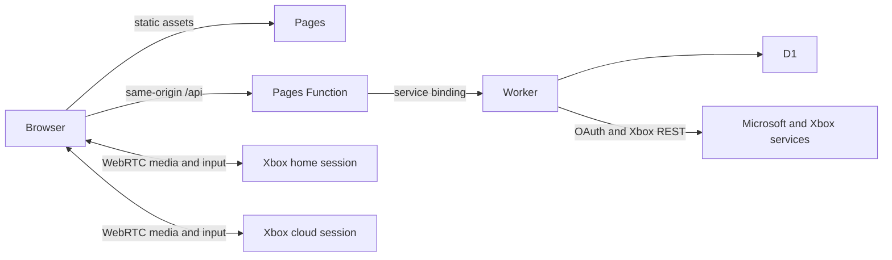

# Architecture

The Pages Function streams the original HTTP request and response through the API binding, preserving the public origin and cookie headers. The API Worker has its public workers.dev route disabled. Its configured origin controls accepted request origins. API responses disable caching and referrer disclosure. Frontend assets use a separate Pages headers policy.

D1 stores OAuth and session state. Credentials are encrypted using the Worker secret. Ownership of a service session is tied to the local application session before any signaling is forwarded. See docs/AUTH.md for the supported identity flow.

The Worker reserves a D1 session slot per signed-in browser before calling either play endpoint. Each local handle binds its mode, owner, region and upstream identifier. Existing handles default to xHome after migration. The browser waits for pending teardown before starting the next player.

Workers carry small control requests. The player negotiates the browser peer connection, attaches audio and video, and serializes controller input. Reachability depends on the console and the candidates offered by the streaming service. Pages and Workers supply neither TURN capacity nor a UDP media endpoint. Browser settings live on the device where the controller and display are used.
